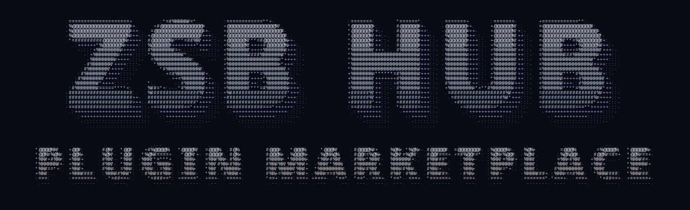

<div align="center">

<a href="assets/marketplace-ascii.txt"></a>

<h1>ZSB Hub External Plugin Marketplace</h1>

<p>Install community plugins from GitHub inside the ZSB Hub desktop app.</p>

<p>
  <a href="https://github.com/rowkav09/zsb-hub-plugin-marketplace#bundled-plugin-directory"><strong>Browse plugins</strong></a> ·
  <a href="https://github.com/rowkav09/zsb-hub-plugin-marketplace/releases/download/marketplace-v1.1.0/zsb-marketplace-1.1.0.zip"><strong>Download the marketplace ZIP</strong></a> ·
  <a href="docs/framework.md">Framework</a> ·
  <a href="https://github.com/rowkav09/zsb-hub-plugin-marketplace/issues/new?template=submit-plugin.yml"><strong>Submit a plugin</strong></a>
</p>

[](https://github.com/rowkav09/zsb-hub-plugin-marketplace/actions/workflows/check.yml)
[](LICENSE)

</div>

## Install the External Marketplace

1. [Download the External Marketplace ZIP](https://github.com/rowkav09/zsb-hub-plugin-marketplace/releases/download/marketplace-v1.1.0/zsb-marketplace-1.1.0.zip). In ZSB Hub, open **Plugins → Custom plugins → Import .zip** and choose the ZIP.
2. After reviewing the [source](plugins/zsb-marketplace/), enable **Settings → Allow unverified plugins**, then turn on **ZSB Hub External Plugin Marketplace** in Plugins.
3. In **External Marketplace**, choose **Check for updates** to refresh the catalog. Install a new plugin from its listing or confirm an **Update** under **Updates available**. Enable newly installed plugins from the normal **Plugins** list.

This is a community feed served from this GitHub repository. The Hub's official catalog remains available under **Plugins**. The desktop panel integration was tested with [ZSB Hub 1.2.7-beta.1](https://github.com/GothGirlZSB/zsb-hub-releases/releases/tag/v1.2.7-beta.1) on Linux. [Installation and troubleshooting](docs/install.md)

| Community plugin | What it does | ZIP |
| --- | --- | --- |
| [External Marketplace](plugins/zsb-marketplace/) | Lists, installs and updates community plugins from this repository. | [Download](https://github.com/rowkav09/zsb-hub-plugin-marketplace/releases/download/marketplace-v1.1.0/zsb-marketplace-1.1.0.zip) |
| [Daily reports](plugins/daily-reports/) by Gufries | Tracks daily gains, clicks, downtime and plugin activity, including Auto Forge counters. | [Download](downloads/daily-reports-1.0.1.zip) |
| [Terminal opener](plugins/terminal-opener/) by Gufries | Opens Genesis and Dead Hand terminals on selected accounts. Accepted offers spend account balance. | [Download](downloads/terminal-opener-1.0.0.zip) |
| [Skillmap Presets](plugins/skillmap-presets/) | Preview and apply skill builds across farm accounts within per-account limits. Requires Hub 1.2.8+. | [Download](downloads/skillmap-presets-1.0.2.zip) |
| [Auto Grind](plugins/auto-grind/) | Level accounts toward 5,000 Premier with repeated case opening, staged skillmaps and cash reserved for the next unlocked skill. | [Download](downloads/auto-grind-1.0.0.zip) |
| [Auto Forge](plugins/auto-forge/) | Pick skins from inventory, approve a capped batch, and optionally chain upgrades to Legendary. Requires Hub 1.2.8+. | [Download](downloads/auto-forge-1.1.1.zip) |
| [Auto Skin Collection Completer](plugins/auto-skin-collection/) | Open owned cases first, buy to fill gaps, submit drops and claim rewards. Track per-account collection progress and estimate Armory costs using rarity odds. | [Download](downloads/auto-skin-collection-1.3.0.zip) |
| [Auto Trade Favourites](plugins/auto-trade-favourites/) | Send favourites from farm accounts to a collector under value and trade caps. | [Download](downloads/auto-trade-favourites-1.0.0.zip) |
| [Auto Sort SU](plugins/auto-sort-su/) | Sort skins into storage units with priority rules per account. | [Download](downloads/auto-sort-su-1.0.0.zip) |
| [Auction Sniper](plugins/auction-sniper/) | Preview and place capped autobids from the Hub main account. | [Download](downloads/auction-sniper-1.0.1.zip) |
| [Farm Value](plugins/farm-value/) | Track aggregate inventory, cash and tokens on a line chart inside Hub. | [Download](downloads/farm-value-1.1.1.zip) |
| [Routed Account Setup](https://github.com/rowkav09/zsb-hub-account-setup/tree/v1.2.0) | Create a new account through its farm route, verify email and optionally enroll it in Auto Grind. External release for Hub 1.2.8 and 1.2.11. | [Download](https://github.com/rowkav09/zsb-hub-account-setup/releases/download/v1.2.0/zsb-account-setup-1.2.0.zip) |

## Bundled plugin directory

Bundled versions were inspected in the Linux beta. The publisher's signed feed has its own versions. The [marketplace catalog](catalog.json) records runtime behavior, compatibility and provenance for each entry.

| Plugin | Category | Bundled | Signed feed | What it does |
| --- | --- | --- | --- | --- |
| **Armory** | Farming | 1.15.0 | 1.14.4 | Rotates accounts through games for pass XP and opens a credit shop. |
| **Games** | Farming | 1.8.0 | 1.8.0 | Targets game reward tiers or Armory XP. |
| **Missions** | Rewards | 1.1.0 | 1.1.0 | Claims finished missions and displays progress. |
| **Monthly pass** | Rewards | 1.3.0 | 1.3.0 | Claims eligible free or Pro monthly pass tiers. |
| **Rewards** | Rewards | 1.3.0 | 1.3.0 | Claims ready rank, click, vault and other reward tiers. |
| **Converter** | Inventory | 1.4.0 | 1.4.0 | Converts cases, skins and capsules into tokens. |
| **Opener** | Inventory | 1.8.0 | 1.6.0 | Previews and opens cases, capsules or collections. |
| **Trader** | Inventory | 1.6.0 | 1.5.0 | Moves tokens and items through one-off trades or saved routes. |
| **Effects** | Inventory | 1.0.0 | — | Buys, sells, activates and queues special effects. |
| **Proxy manager** | Infrastructure | 1.1.0 | 1.1.0 | Publishes proxy and WireGuard routes to the farmer. |

[Machine-readable catalog](catalog.json) · [Publisher catalog snapshot](https://github.com/GothGirlZSB/zsb-hub-releases/blob/37cd27f8b422d928e729d7082d9b1ea601990b5a/plugins/catalog.json)

## Build a plugin

A plugin starts with a `plugin.json` manifest and a CommonJS entry point. ZSB Hub calls `start(ctx)` to give it access to the farmer and panel APIs.

```js
module.exports = {
  start(ctx) {
    ctx.panel.tab('My Plugin', () => ({
      blocks: [{ type: 'text', text: `${ctx.accounts.list().length} accounts` }],
    }));
  },
};
```

| Resource | What it covers |
| --- | --- |
| [Authoring guide](docs/authoring.md) | Build, package and import a minimal plugin. |
| [Framework API](docs/framework.md) | Lifecycle, settings, requests, schedules, events, panel blocks and coordination. |
| [Distribution](docs/distribution.md) | ZIP layout, catalog bundles and publisher signatures. |
| [SKILL.md](SKILL.md) | Give an agent the relevant framework rules and verification steps. |

## Submit your plugin

[Open the plugin submission form](https://github.com/rowkav09/zsb-hub-plugin-marketplace/issues/new?template=submit-plugin.yml) with your **source**, a **versioned ZIP**, and the **ZSB Hub build you tested**. Tell us what it reads or changes. The form works without a clone or pull request. [Contribution guide](CONTRIBUTING.md)

## Verify the catalog and plugins

Use Node.js 24 and Python 3.10+. CI validates the catalog, compares local ZIPs with their source, statically scans installable ZIPs for suspicious behavior, exercises the install flow with fixtures, and verifies the pinned publisher signatures. [Plugin security checks](CONTRIBUTING.md#plugin-security-checks)

```sh
npm ci
npm run check
npm run check:packages
npm test
npm run check:publisher
```

## License and attribution

The original marketplace code and docs use the [MIT License](LICENSE). Daily reports and Terminal opener are credited to Gufries. Their downloaded ZIPs did not include a license. [Original Discord release post](https://discord.com/channels/1042469313820495952/1566908059555594290/1571322249494138973) ZSB Hub and its publisher plugins are distributed upstream. This is an independent community directory. [ZSB Hub releases](https://github.com/GothGirlZSB/zsb-hub-releases)
